# Slop or Not

A 10-round game that plays inside an X post. Each round shows one image. Tap **AI** or **Real**, see the answer, and move on. At the end you get a score, can put a nickname on a global top 10, and get a share link that unfurls as "I got 7/10. Can you?".

After a game, **Level 2** is offered. It looks the same, but all 10 images are AI, drawn from a pool of hard ones that pass as boring phone photos. Rounds show a neutral "Locked in" instead of the answer, and the end screen reveals "All 10 were AI." with how many you called real. Level 2 has its own board, ranked by AI images spotted, and its own share card ("Fooled 7/10. Can you?").

| Start | Round | Reveal | End | Share card |
|---|---|---|---|---|
| 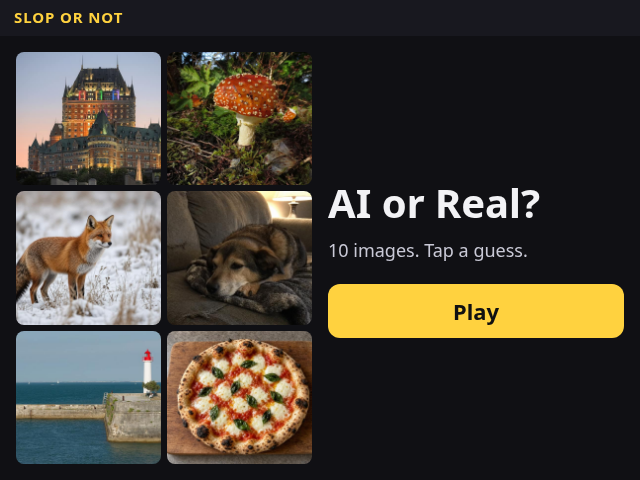 | 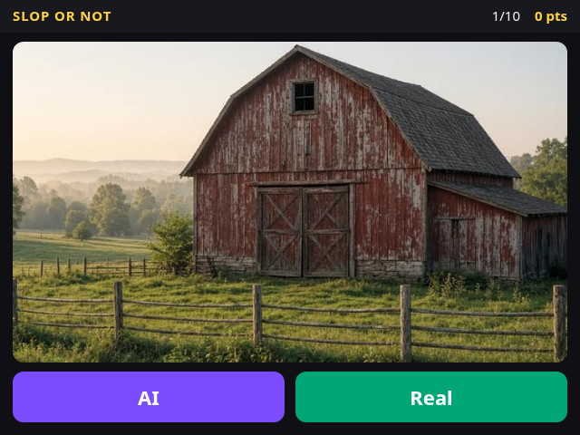 | 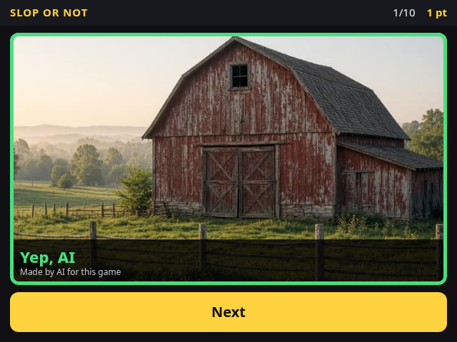 | 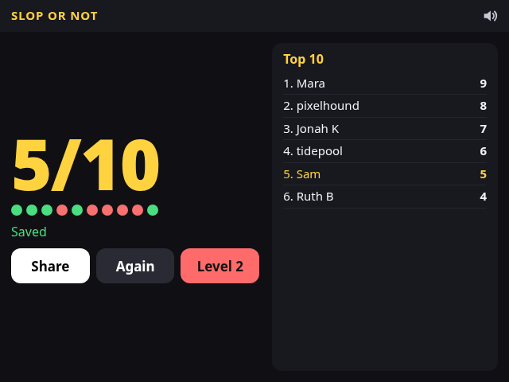 | 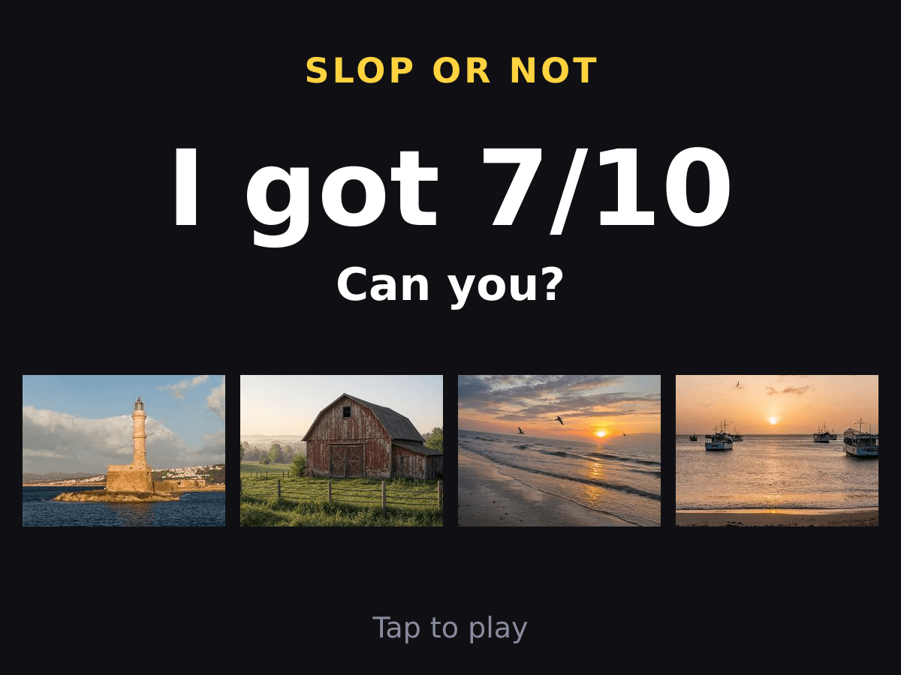 |

| Level 2 round | Locked in | Level 2 reveal | Level 2 board | Level 2 share card |
|---|---|---|---|---|
| 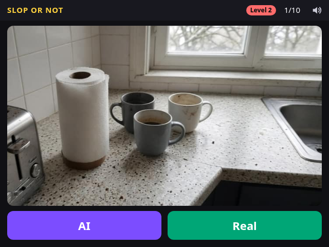 | 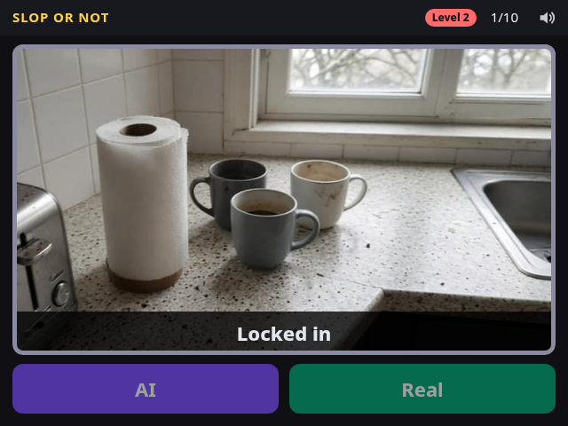 | 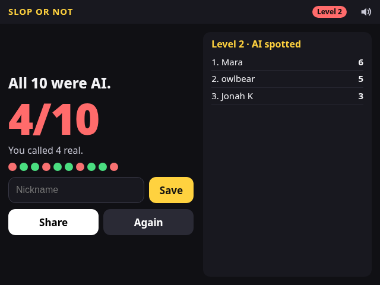 | 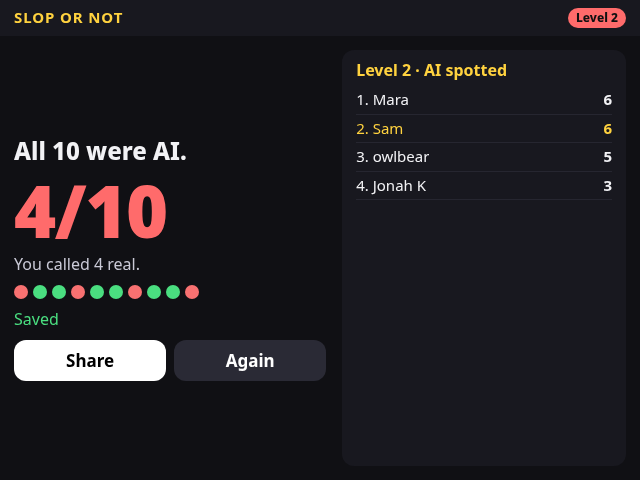 | 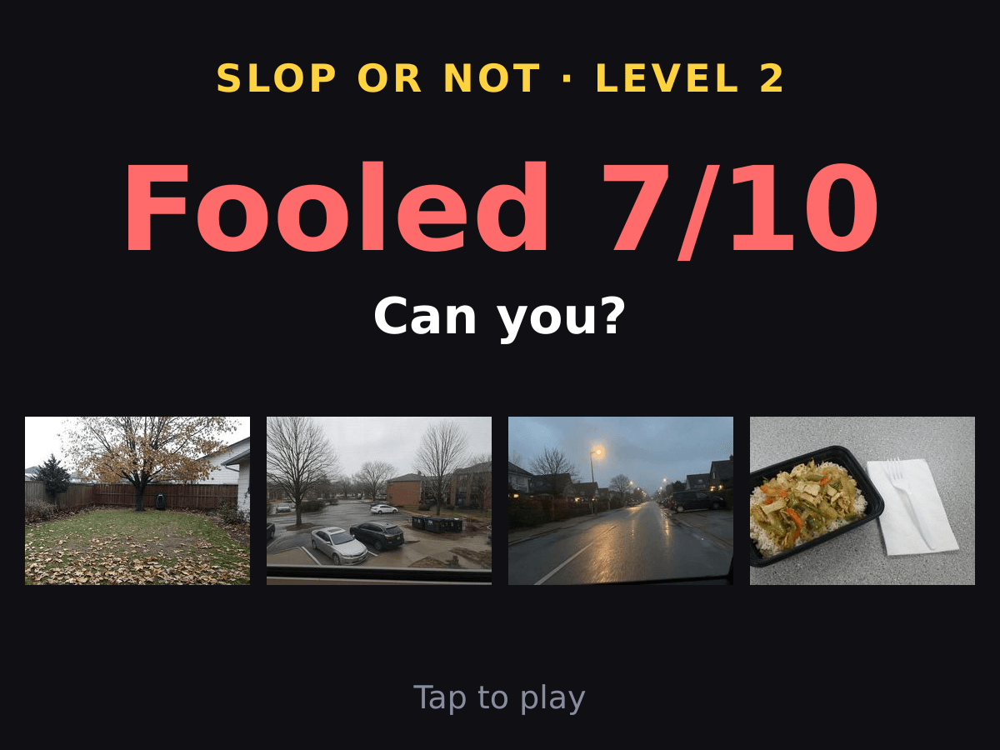 |

### Sound and phones

- **Sound:** the same lo-fi music as the trailer, as a seamless 24-second loop (`public/audio/loop.mp3`, 235 KB, built by `scripts/build-loop.py` from the bed that `scripts/build-audio.py` synthesizes), plus WebAudio-synthesized effects in `public/audio.js` (tap, correct, wrong, score reveal, Level 2 unlock, "All 10 were AI."). Nothing is created or played before the first tap. The music plays through an `<audio>` element, not WebAudio, because iPhones mute Web Audio alone with the silent switch (and in-app browsers like X behave the same); a playing media element puts the page in the "playback" audio session (plus `navigator.audioSession.type = 'playback'` where supported), which also lets the effects through. Audio starts synchronously inside the tap (`touchend`, `pointerup`, `click`), never after an await. The speaker button starts the sound if it is not running yet, otherwise toggles mute (red crossed icon, `aria-pressed`), saved in `localStorage`. In Level 2 every answer makes the same neutral "locked in" sound. The D1-served static files support byte-range requests (206), which iOS needs for media elements.
- **Portrait phones** (mobile Safari, Chrome, the X in-app browser): full-height layout using `100dvh` and safe-area insets, big buttons, the whole image shown (`object-fit: contain`), and no scrolling.
- **The card on a phone:** X's own panel covers about the bottom 30% of the player. On a touch device the card keeps every control in the top 70% (`html.card-touch`), and a compact layout handles the scaled-down ~360x270 card.

| iPhone 14 | Pixel 7 | Card on a phone (shaded = covered by X) |
|---|---|---|
| 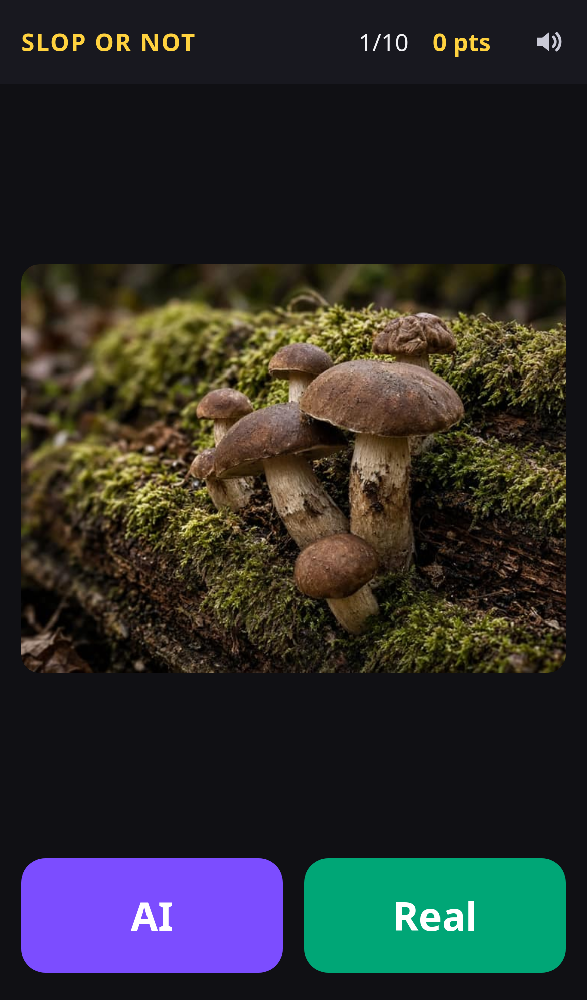 | 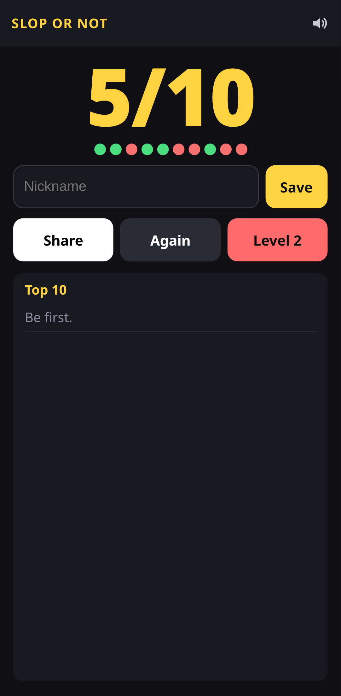 | 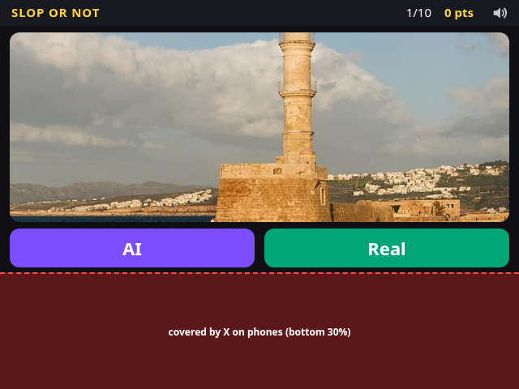 |

Live: **https://slop-or-not.brettr7388.workers.dev/play** · Image credits: [CREDITS.md](CREDITS.md).

## How the in-tweet card works

X still supports the old **Player Card**. When a post links to a page that declares `twitter:card=player`, X loads the `twitter:player` URL in an iframe inside the post. This project follows the [x-player-card skill](https://github.com/TarasShyn/skills/tree/main/skills/x-player-card).

- `/play` is both the share URL and the player URL. It emits exactly one `twitter:card` (`player`), `twitter:player` pointing at `/play`, `twitter:player:width=640`, `twitter:player:height=480`, a `twitter:image` poster, and no `twitter:player:stream`.
- `/play` responds with `Content-Security-Policy: frame-ancestors 'self' https://x.com https://*.x.com https://twitter.com https://*.twitter.com` and no `X-Frame-Options`. The wildcards cover `mobile.x.com`, `mobile.twitter.com` and `www.` variants. Every other HTML route keeps `frame-ancestors 'self'`.
- The layout fits the frame with no scrolling. Input is taps only. There is no login: you type a nickname. When the page detects it is framed, every link opens in a new tab.
- `/s/<0-10>` is the share page for a score. It has its own `og:image` and `twitter:image` (`/share/<n>.png`) and is also a player card, so a shared score is playable in the post too. `/s2/<0-10>` is the Level 2 version (`/share/l2-<n>.png`, n = images that fooled you). Neither page says Level 2 is all AI.
- X caches the card per URL. If a post went out while the tags were wrong, post a new path instead of the same one.

Check what X's crawler sees after deploying:

```bash
curl -s -A "Twitterbot/1.0" https://YOUR_DOMAIN/play | grep -o '<meta name="twitter:[^>]*>'
curl -s -o /dev/null -D - -A "Twitterbot/1.0" https://YOUR_DOMAIN/play | grep -i 'content-security\|x-frame'
```

The X mobile apps may not run player cards. Other builders report that desktop works reliably and mobile is hit or miss.

## Stack

- One Cloudflare Worker (`src/worker.js`) serves the HTML routes and the API. Static files in `public/` (the game JS and CSS, images and share cards) are served as Worker assets.
- D1 (`migrations/`) holds game sessions and the leaderboard. Everything fits the Workers free plan.
- The front end is plain HTML, CSS and JS (`public/app.js`). There is no build step.

### Scoring happens on the server

The browser never learns an answer before it guesses, and it never reports a score.

1. `POST /api/session` creates a session. The server picks 10 images and stores the deck, level and progress in D1 under a random 128-bit session id. It returns the id and the 10 image URLs, with no labels. A Level 1 deck is random but always holds 2 or 3 images from the hard AI pool. A Level 2 deck (`{ level: 2, after: <finished level 1 session> }`) is 10 hard-pool images; without a finished Level 1 game in the last 2 hours it gets `403 locked`.
2. `POST /api/guess` with `{ session, round, guess }` answers one round. The server checks that `round` is the next unanswered round, scores it, and returns `correct`, the true answer and the photo credit. In Level 2 it returns only `{ locked: true, round, done }`, so the answers cannot leak round by round; the last round adds `{ score, calledReal, allAi: true }`. The update is conditional on the round, so replays, skipping ahead and parallel answers to the same round get `409 out_of_order`.
3. `POST /api/score` with `{ session, name }` saves the score and level the server holds for that session (Level 2 score = AI images called AI). A session must have all 10 rounds answered (`409 not_finished`), and a unique index on `scores.session_id` allows one entry per session (`409 already_submitted`). Any `score` field in the body is ignored.

The answer key lives in `src/deck.js`, which is generated by `scripts/build-images.mjs` and bundled into the Worker. It is not in `public/`, so it is never served. `credits.json` stays in the repo and is not served either. Image file names are a hash of the image bytes, so a URL says nothing about the label. Sessions expire after 2 hours, and rows older than a day are pruned when new sessions start. No secret is needed: the session id is random and all state is server-side.

### API

| Route | What it does |
|---|---|
| `GET /api/preview` | 6 random image URLs for the start screen |
| `POST /api/session` | `{ level?: 1 \| 2, after? }` starts a game: `{ ok, session, level, rounds, images }` |
| `POST /api/guess` | `{ session, round, guess: "ai" \| "real" }` returns `{ correct, answer, credit, score, round, done }` (Level 2: `{ locked, round, done }`) |
| `POST /api/score` | `{ session, name }` returns `{ ok, id, score, level, top }`. The client highlights its own row by `id` |
| `GET /api/leaderboard?level=1\|2` | Top 10 for that level as `{ ok, level, top: [{ id, name, score }] }` |
| `GET /api/stats` | Submitted-score distributions per level: `{ levels: { 1: { games, distribution: [n0..n10] }, 2: ... } }` |

### Stats

Every graded guess is logged to the D1 table `guesses` (image, level, guess, correct, timestamp; no IP, session or name). The daily session cleanup never touches this table. Per-image "% fooled" would give away the answer key, so it is not served by the Worker. `npm run stats` (add `-- --remote` for the deployed D1 or `-- --json` for JSON) joins the log with the repo-only `credits.json` and prints % fooled per image along with the score distributions. Only the aggregate distributions are public, at `/api/stats`.

### Anti-spam and limits

- Names are 1 to 16 characters (letters, numbers, space, `.`, `_`, `-`) and pass a profanity filter that handles leetspeak and spacing tricks (`src/validate.js`).
- Each IP can start 20 sessions per minute and submit 3 scores per minute and 30 per day. The checks and inserts run as single SQL statements, so a burst of parallel requests cannot slip past them. Only a salted hash of the IP is stored (`IP_SALT`, optional).

What this does not stop: the pool has 101 images, so someone who plays many games can memorise which picture is which. Hard-pool images are revealed as AI when they come up in Level 1, so a player who has seen enough of them can spot them in Level 2. Scripted play is possible too, since there are no accounts. Growing the image pool raises the cost of memorising.

## Run locally

**Node 22 or newer is required.** Wrangler refuses to run on Node 20.

```bash
npm install
npm run db:migrate:local
npm run dev            # http://127.0.0.1:8787/play
npm test               # unit tests for validation and the profanity filter
npx playwright install chromium
npm run seed:demo      # optional: a few demo leaderboard rows
npm run test:e2e       # plays a full game in headless Chromium against wrangler dev
```

The e2e script:

- Checks that no static path serves an answer map, and checks the card tags and headers as Twitterbot.
- Plays 10 rounds at 640x480 and checks each server verdict and that 2-3 hard images appeared, then submits a nickname and checks that exactly that row is highlighted.
- Taps **Level 2**, plays it, and checks every image is from the hard AI pool, each round shows only "Locked in", the end says "All 10 were AI." with the right count, and the score lands on the Level 2 board.
- Over the API: Level 2 is locked without a finished Level 1 game, Level 2 decks are 10/10 hard AI, Level 2 guesses carry no answers, and the two boards share no rows.
- Loads the game in a same-origin `scrolling="no"` iframe.
- Tries a forged score, a replayed submit, out-of-order and parallel guesses, a profane name, and bursts of submits and session starts.

Screenshots go to `screenshots/`.

`npm run test:audio` (local only: it refuses non-local URLs because it starts games) checks the sound on an iPhone 14 (WebKit) and in a 640x480 cross-origin iframe like the X card (WebKit and Chromium): after the Play tap the AudioContext is running, master gain is above 0 and the music element is playing with its time advancing; the speaker toggles icon, `aria-pressed`, gain and element mute; and on a fresh page the speaker alone starts audio. Run it against `npx wrangler dev -c wrangler.d1-assets.toml --port 8788` after `node scripts/load-local-assets.mjs`, which mirrors the live D1-served static files.

`npm run test:mobile` (needs `npx playwright install webkit chromium`) plays a game as an iPhone 14 (WebKit) and a Pixel 7 (Chromium) in portrait. It checks that nothing scrolls, that every tap target is at least 44x44 px, that audio starts, and that mute survives a reload. It then plays both levels on a touch card at 640x480, and in a 360x270 frame, and checks that every control sits in the top 70%. These scripts never submit a name, so they can run against the live site with `--allow-remote` without touching the leaderboard.

`test:e2e` and `seed:demo` write leaderboard rows, so they refuse any `BASE_URL` that is not localhost. Pass `--allow-remote` or set `E2E_ALLOW_REMOTE=1` only if you really want to write to that server.

## Deploy

1. Log in to Cloudflare: `npx wrangler login` (or set `CLOUDFLARE_API_TOKEN` with Workers Scripts and D1 edit permissions).
2. Create the database: `npx wrangler d1 create slop-or-not`, then paste the printed `database_id` into `wrangler.toml`.
3. Apply the schema: `npm run db:migrate:remote`.
4. Optional: `npx wrangler secret put IP_SALT` with any random string (the default salt is public, which only matters if the D1 data leaks). `X_HANDLE` in `wrangler.toml` (`@Bro7388`) sets the `twitter:site` tag.
5. Ship it: `npm run deploy`. Add a custom domain in the Cloudflare dashboard if you want one. The card tags use whatever origin the request came in on, so nothing else needs editing.
6. Run the two `curl` commands above against the live URL, then post `https://YOUR_DOMAIN/play` from a test account first.
7. Optional smoke test: `BASE_URL=https://YOUR_DOMAIN node scripts/e2e.mjs --allow-remote --no-guards` plays one game of each level and writes two leaderboard rows. Delete them afterwards. Live screenshots from that run are in `docs/live/`.

### Deploying without wrangler (REST API)

The live copy was deployed over the Cloudflare REST API rather than `wrangler deploy`, and that path could not use the Workers static-asset upload. For that case `deploy/entry.js` wraps the same Worker: when there is no `ASSETS` binding, it serves `public/` from a D1 table, `static_assets`, through `deploy/d1-assets.js`. `deploy/upload-assets.mjs` fills that table. Bundle the entry with `npx wrangler deploy deploy/entry.js --dry-run --outdir dist`, then upload `dist/entry.js` with a `DB` D1 binding and an `IP_SALT` secret. A normal `wrangler deploy` ignores all of this.

## Images and credits

`credits.json` lists the source, license, author and label of all 101 game images, and [CREDITS.md](CREDITS.md) is the readable version (`scripts/build-credits.mjs`). Both are kept in the repo for attribution and are not served by the game.

- **45 real photos** come from Wikimedia Commons and are all CC0. 5 of them are tagged `too_perfect`: glossy shots (aurora, lavender field, kingfisher, jellyfish, lorikeet) picked because they look AI-made (`scripts/fetch_perfect.py`). Each license was read from the Commons API (`extmetadata.License`) by `scripts/fetch_commons.py`, and every image was checked by eye to make sure no identifiable people appear. The subjects are landscapes, food, animals, objects and buildings.
- **56 AI images** were generated for this project with Grok Imagine. 32 use the same subjects as the real photos, so the subject never gives the answer away. 24 are tagged `hard`: dull, imperfect phone-photo scenes (a parking lot, dirty dishes, a messy desk) with no text, faces or hands. These were kept from 28 generated after a review by eye. The prompt for each one is in `credits.json`. The project dedicates them to the public domain under CC0.
- All images are cropped to 720x540 and have all metadata stripped (EXIF, XMP, IPTC, ICC, C2PA, PNG text). `exiftool` finds none in `public/`. File names are hashes of the image bytes, so neither the name nor the EXIF reveals the answer.

To rebuild the images, run `python3 scripts/fetch_commons.py`, put the AI originals in `raw/ai/` and `raw/hard/`, then run `npm run build:images`. This writes `public/img/`, `src/deck.js`, `credits.json` and the share cards. The original files are not committed, but `raw/*/candidates.json` records where each one came from.

## License

The code is MIT. The images keep the licenses listed in `credits.json`.
